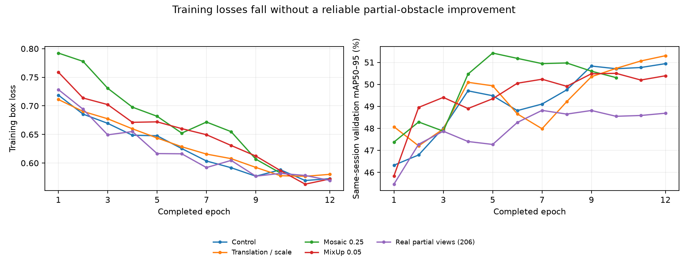

# Partial-obstacle detection results — 2026-11-23

The existing detector is retained at `models/barriers_640/weights/best.pt`. Five completed training variants did not improve overall revised validation performance, and all six evaluated models missed all five hood-only views in the newer recording. The label and evaluation pipeline is improved; a reliable partial-obstacle model improvement was not demonstrated.

The control did show a modest improvement on the known regression clip, driven by trains and ground barriers. That did not improve the target hood-only failure, and model selection was frozen before those regression results were opened.

## A. Annotation audit

All **1,035 old-session images** were reexamined on aspect-preserving contact sheets; correction candidates received native-pixel crops and separate overlay checks. Labels remain **AI-assisted drafts, not verified human ground truth**.

| Class | Added | Adjusted | Removed | Current boxes, all 1,035 frames |
| --- | --- | --- | --- | --- |
| train | 27 | 17 | 0 | 2636 |
| ground_barrier | 0 | 8 | 0 | 566 |
| overhead_barrier | 60 | 3 | 0 | 477 |

The 115 row changes affect **103 images**. Every old/new row, class, native visible bounds, reason and review provenance is recorded in `data/labeling/batch_001/partial_audit.json`, together with complete before/after rows and label fingerprints. Examples:

- Frames 169–176: add the real blue cap/chevron fragments visible behind the center train; hidden supports were not reconstructed.
- Frames 187–204: correct the moving right-train roof bounds and retain confidently visible bottom-edge fragments.
- Frames 336–357: add small exposed train fragments; frames 336–338 also receive visible support/base corrections.
- Frame 882: retain the confidently identifiable thin train roof clipped by the bottom boundary.
- Frames 869–920: add visible portions of the raised chevron behind the blue train. Tiny earlier cases remain explicitly excluded from scoring.
- Frames 907–914: ground boxes stop enclosing coins above the beam and include the visible support/base structure.
- Broad foreground overhead boxes 387–388 were inspected and preserved as naturally broad visible objects.

There are **118 uncertain frames**, including previously excluded camera/obscured frames. Of the original 876 eligible frames, 810 remain usable; 225 of 1,035 are excluded by combined eligibility/uncertainty rules. The standard one-in-three chronological split uses **200 training frames <=780 and 144 validation frames >=850**, with frames 781–849 held out as a gap. Thirty-seven former validation frames are excluded for unresolved extent/visibility ambiguity. They remain available for review. These changes alter absolute scores, so all models were reevaluated on the same revised labels and exclusions.

| Split | Frames | Train boxes | Ground boxes | Overhead boxes |
| --- | --- | --- | --- | --- |
| Standard training | 200 | 460 | 135 | 97 |
| Revised validation | 144 | 427 | 102 | 126 |
| Newer regression sample | 92 | 245 | 59 | 8 |

These are box instances across correlated video frames, not counts of independent physical obstacles. The additional data-coverage control uses 206 early frames: it retains all eight newly reviewed partial-barrier frames rather than the two retained by uniform sampling. It adds six real screenshots once each, keeps the same validation split, and changes no pixels.

[Before/after overlays](../data/labeling/batch_001/review/partial_before_after.jpg) · [All-frame gallery](../data/labeling/batch_001/review/index.html)

### Image integrity and negatives

All **1,955 source screenshots** retain their recorded SHA256 fingerprints and dimensions: 1,035 at 1412×814 and 920 at 1284×793. All 1,127 labeled files pass finite/class/geometry checks, with 1e-6 normalized rounding tolerance. Both earlier checkpoints retain their original hashes. Full proof is in `models/partial_experiments/integrity.json`.

No usable old-session background-only image was confidently verified. Its 54 empty-label files belong to menus or obscured-camera views; none was added as a training negative. Two newer-session frames 910 and 920 were visually verified to contain no target objects and were kept exclusively in regression. The frozen model falsely detects their bats as a ground barrier and a train. These two adjacent frames are only a preliminary hard-negative check.

[Verified-negative false detections](../models/partial_experiments/verified_negative_errors.jpg)

## B. Controlled training experiments

Every candidate starts from the same frozen checkpoint SHA256 `3408b9b9bb1515b5396ff8ad3a0e471d96e31bafd80f9d81e9dc431df7a00ad6`. CPU verification confirmed all 499 source state tensors transfer without a reset; the YOLO11n architecture and three classes stay fixed.

The matched augmentation runs use the same 200 images, seed 42,640 px, batch 2, AdamW learning rate 0.0003, one warmup epoch, maximum 12 epochs, patience 5 and **no time cap**. Only the named augmentation changes. The separate 206-frame experiment uses control transforms and changes data selection only. Checkpoints are selected using the trainer natural-validation mAP50–95; the trainer internally validates at batch 4, while all comparison tables below are freshly reevaluated at batch 2.

| Run | Change | Epochs completed | Selected epoch | Recorded wall minutes |
| --- | --- | --- | --- | --- |
| Control | Existing transforms: translate 0.05 / scale 0.20 | 12 | 12 | 5.7 |
| Translation / scale | translate 0.10 / scale 0.25 | 12 | 12 | 33.6 |
| Mosaic 0.25 | mosaic 0.25; final 3 scheduled epochs close mixing | 10 | 5 | 4.5 |
| MixUp 0.05 | mixup 0.05 | 12 | 10 | 4.5 |
| Real partial views (206) | Retain six additional reviewed early partial views | 12 | 7 | 5.4 |

The translation/scaling run contains long wall-clock pauses, including its first and eighth epochs. Completed epochs and optimizer-update budgets were recorded rather than hidden behind a short time limit; the cause of those pauses was not profiled. Mosaic stopped early after its validation peak. Other capped runs are bounded experiments, not evidence of complete convergence or optimal hyperparameters.

Augmented samples were inspected separately from source images. Mosaic produces physically implausible stacked/duplicated scenes despite conservative probability. Active MixUp examples visibly weaken already-small barriers. Neither is retained. [Active MixUp preview](../models/partial_mixup/mixup_active.jpg).

Installed detection CutMix deliberately avoids overlap with primary boxes, so it does not directly simulate occluding an existing target. A custom visible-extent-safe occluder would add complexity and uncertain labels; it was skipped. Classification-only erasing was not used for detection. The earlier pasted-hood dataset/generator was removed and its run marked rejected. No combination experiment was justified by the individual results.

### Revised natural validation —144 frames

| Model | mAP50 | mAP50–95 | Precision | Recall |
| --- | --- | --- | --- | --- |
| Existing frozen model | 81.24% | 51.69% | 89.07% | 70.90% |
| Control | 79.59% | 50.93% | 93.48% | 70.91% |
| Translation / scale | 78.96% | 51.32% | 92.13% | 65.96% |
| Mosaic 0.25 | 78.23% | 51.36% | 92.21% | 68.23% |
| MixUp 0.05 | 77.46% | 50.50% | 91.11% | 70.07% |
| Real partial views (206) | 76.39% | 48.79% | 89.81% | 66.83% |

Per-class mAP50:

| Model | Train | Ground barrier | Overhead barrier |
| --- | --- | --- | --- |
| Existing frozen model | 94.43% | 88.28% | 61.01% |
| Control | 94.71% | 88.09% | 55.97% |
| Translation / scale | 94.41% | 84.81% | 57.65% |
| Mosaic 0.25 | 94.52% | 86.08% | 54.07% |
| MixUp 0.05 | 94.67% | 86.64% | 51.06% |
| Real partial views (206) | 92.64% | 83.58% | 52.95% |

The archived approximately 94.5% figure is not a supported overall baseline. The available archived reevaluation records 94.47% for the **train class**, with 83.36% overall for that older model/split revision. Its raw training curve peaks at 74.53% overall; the later 640 run peaks at 89.08%. Those historical labels/splits are not the new comparison population. The frozen starting model now scores 81.24% overall on the revised 144-frame validation set.

### Fixed operating point — confidence 0.25, class-correct IoU>=0.5

| Model | Reviewed occluded subset | Small objects | Image-edge objects | Near-player barriers | FPs: train / ground / overhead |
| --- | --- | --- | --- | --- | --- |
| Existing frozen model | 0/41 | 116/214 | 190/206 | 12/15 | 71 / 45 / 3 |
| Control | 0/41 | 115/214 | 194/206 | 13/15 | 104 / 25 / 0 |
| Translation / scale | 0/41 | 112/214 | 190/206 | 11/15 | 135 / 58 / 2 |
| Mosaic 0.25 | 0/41 | 117/214 | 193/206 | 14/15 | 143 / 70 / 3 |
| MixUp 0.05 | 0/41 | 109/214 | 194/206 | 14/15 | 93 / 25 / 3 |
| Real partial views (206) | 0/41 | 114/214 | 184/206 | 10/15 | 121 / 48 / 5 |

The occluded validation subset follows a strongly correlated partial-barrier trajectory. There are no confidently tagged hood-only validation examples. Only one fully visible object is explicitly tagged for subgroup comparison, so it is an example-level check rather than a reliable fully-visible population score.

Small means longest side<=32 pixels at 640 input, not measured distance. Image-edge means the visible box touches a boundary within one native pixel. Near-player means a barrier bottom falls in the lower 30% of the image; this is a position proxy, not collision timing. FPs cannot be assigned a nonexistent ground-truth visibility category, so they are reported per class and verified negative frame. Unmatched predictions include duplicates, class errors and poor localization as well as hallucinations. AP-derived P/R use the validator matching/threshold procedure and need not equal this fixed-point matcher.

### Locked newer-session regression —92 labeled samples from 920 frames

This recording had already informed the diagnosis, so it is **not an untouched independent test**. Its two previously corrected ground-label omissions were versioned before these experiments; this task did not alter its label rows. The eight overhead examples follow one physical barrier, with five hood-only views. Validation selection was saved in `selection.json` before candidate regression scoring; no further training/tuning followed these scores.

| Model | mAP50 | mAP50–95 | Precision | Recall | Hood-only detections | FPs on two verified negatives |
| --- | --- | --- | --- | --- | --- | --- |
| Existing frozen model | 66.61% | 45.16% | 87.71% | 61.69% | 0/5 | 2 |
| Control | 67.50% | 45.78% | 91.22% | 60.00% | 0/5 | 1 |
| Translation / scale | 64.78% | 44.73% | 84.24% | 57.24% | 0/5 | 1 |
| Mosaic 0.25 | 64.42% | 44.47% | 85.94% | 55.53% | 0/5 | 2 |
| MixUp 0.05 | 66.87% | 45.40% | 91.34% | 61.37% | 0/5 | 7 |
| Real partial views (206) | 62.70% | 42.11% | 92.05% | 53.32% | 0/5 | 3 |

Regression per-class mAP50:

| Model | Train | Ground barrier | Overhead barrier |
| --- | --- | --- | --- |
| Existing frozen model | 84.56% | 77.03% | 38.25% |
| Control | 85.53% | 79.15% | 37.80% |
| Translation / scale | 85.41% | 77.94% | 30.99% |
| Mosaic 0.25 | 84.26% | 77.28% | 31.73% |
| MixUp 0.05 | 84.24% | 77.86% | 38.50% |
| Real partial views (206) | 85.38% | 76.93% | 25.79% |

The control improves known-regression overall mAP50 by 0.89 points and ground mAP50 by about 2.2 points; ground false positives fall 43→25 with the same 46 true positives. Train recall rises, with more train false positives. Overhead performance and all five hood-only misses remain unimproved, and validation performance is worse. This is an exploratory tradeoff to confirm on fresh data, not a reason to reverse the validation-frozen choice. MixUp has small regression AP changes but increases verified-negative FPs from 2 to 7.

### Mac latency

| Model | Validation-scene median ms | Regression-scene median ms |
| --- | --- | --- |
| Existing frozen model | 36.0 | 16.7 |
| Control | 16.8 | 16.4 |
| Translation / scale | 56.2 | 15.2 |
| Mosaic 0.25 | 16.2 | 17.0 |
| MixUp 0.05 | 15.8 | 16.6 |
| Real partial views (206) | 16.3 | 15.5 |

Measured on this Apple M1 Mac with synchronized GPU calls: 5 warmups then 20 single-image calls, including file-read/preprocessing/NMS overhead. These are scene/load-dependent measurements, not a controlled hardware speed comparison. Screen capture, saving and game controls are outside this timing. The architecture is unchanged; differences should not be interpreted as architectural speedups.

## C. Overfitting and remaining failure

- Existing frozen model: unaugmented training mAP5096.34% on 200 frames versus revised validation 81.24%; gap 15.10 points.

- Real partial views (206): unaugmented training mAP5097.39% on 206 frames versus revised validation 76.39%; gap 21.00 points.


The data-coverage model detects 6/8 reviewed partials in its own training frames but 0/5 hood-only views in the newer encounter. Its overall training score rises while validation/regression remain worse. This is consistent with view-specific learning/overfitting; the different difficulty of the cohorts and AI-assisted label uncertainty also affect the gaps. Training accuracy alone is not an improvement.

Training contains very few distinct partial-barrier encounters. Most of the newly corrected overhead boxes belong to the held-out late block and correctly remain unavailable for training. Retaining eight neighboring early frames adds views, not independent encounters. All models miss the 41 reviewed occluded validation cases at the fixed operating point. The newer hood-only group is one trajectory, and repeated video frames do not create an independent sample of game situations.

There is one fixed seed per experiment and no multi-seed confidence interval. MPS also warns that some operations are not fully deterministic. Small score differences cannot establish broad robustness. Same-session chronology and a gap reduce adjacent-frame leakage but do not create genuine independence. A fresh untouched recording is still required.



The curves show falling training box losses and limited validation progress. Training loss uses augmented images and the validation distribution contains different, harder views; the gap is evidence to investigate, not proof of a single causal mechanism.

## D. Repository changes and reproduction

- `scripts/train.py`: validates finite normalized labels/classes, checks original source hashes, excludes uncertainty without shifting later sampling, enforces chronological/hash separation, refuses unverified empty negatives, records reproducible runs, catches incomplete NMS, and supports isolated transforms plus the reviewed-partial selection control.
- `scripts/evaluate.py`: scores fixed splits without augmentation, honors actual file-loader batch limits, catches NMS timeout truncation in AP and prediction, verifies exact coverage and unchanged inputs, refreshes label caches, records class/subgroup/negative errors and measures synchronized latency.
- `tests/test_dataset.py`, `tests/test_evaluate.py`: meaningful label/integrity/split/empty/uncertainty/configuration/batching/NMS/matching tests. **28 tests pass**, and dependency checks report no broken requirements.
- Label/audit/manifest corrections and regenerated overlay-only gallery/contact sheets; source images remain untouched.
- `README.md`: standing requirements, commands and final recommendation. `docs/superpowers/plans/2026-11-23-partial-detection.md`: execution record.

One evaluation defect was found and corrected before final comparisons: passing a Python list made Ultralytics load all 144 images as a single batch, allowing NMS to abandon remaining outputs. A real loader-boundary test reproduces the ignored batch limit. Final comparisons use split-file sources, bounded batches and timeout rejection, including AP validation.

```bash
.venv/bin/python -m unittest discover -s tests
.venv/bin/python -m pip check
.venv/bin/python scripts/train.py control
.venv/bin/python scripts/train.py translate_scale
.venv/bin/python scripts/train.py mosaic
.venv/bin/python scripts/train.py mixup
.venv/bin/python scripts/train.py partial_views
```

Each experiment prepares its own source image list; completed runs keep snapshots of the exact train/validation paths and input hashes. The standard 200-frame preparation was restored after the 206-frame experiment. Later runs receive numbered folders. Evaluate a checkpoint with:

```bash
.venv/bin/python scripts/evaluate.py models/barriers_640/weights/best.pt data/training/dataset.yaml val models/my_validation
.venv/bin/python scripts/evaluate.py models/barriers_640/weights/best.pt data/labeling/test_001/dataset.yaml test models/my_regression
```

Use each candidate path from the table below for a candidate score. Completed evaluation reports are preserved with numbered output folders. Do not use repeated regression scoring to select hyperparameters.

| Model | Checkpoint |
| --- | --- |
| Existing frozen model | `models/barriers_640/weights/best.pt` |
| Control | `models/partial_control/weights/best.pt` |
| Translation / scale | `models/partial_translate_scale/weights/best.pt` |
| Mosaic 0.25 | `models/partial_mosaic/weights/best.pt` |
| MixUp 0.05 | `models/partial_mixup/weights/best.pt` |
| Real partial views (206) | `models/partial_partial_views/weights/best.pt` |

Aggregate metrics are in `models/partial_experiments/comparison.json`; per-run summaries contain package versions, checkpoint/input hashes and exact evaluation settings. `selection.json` records the pre-regression model choice. `integrity.json` records original-image/dimension and preserved-checkpoint verification. All earlier checkpoints/results remain available.

## E. Recommendation

Retain **`models/barriers_640/weights/best.pt`**. Keep conservative existing transforms (`mosaic=0`, `mixup=0`, `translate=0.05`, `scale=0.2`) as the control; the tested increases did not justify adoption. Keep the corrected annotations, uncertainty exclusions and evaluation safeguards. The six-extra-frame policy remains an explicitly labeled experiment, not the default.

The useful next step is varied **real training footage** containing several independent cap-only/partly hidden barrier encounters, edge fragments and bats/power-ups on clear tracks. Reserve a separate entire recording, label it before examining predictions, and keep it untouched for the final test. More tuning of this one clip is not supported by these results.
